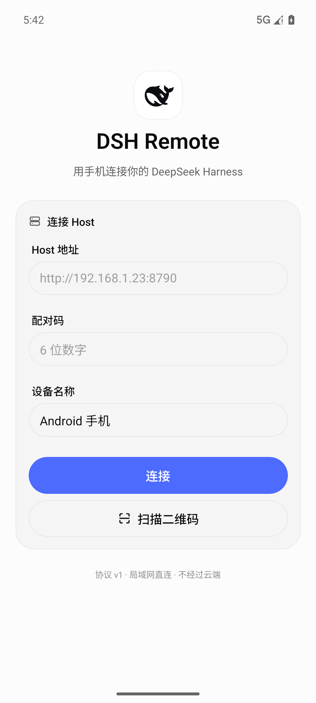
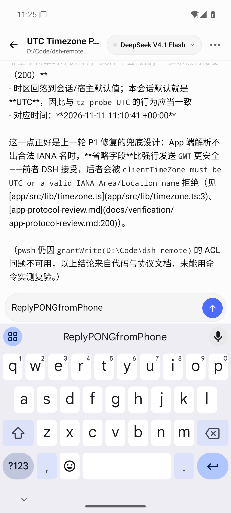
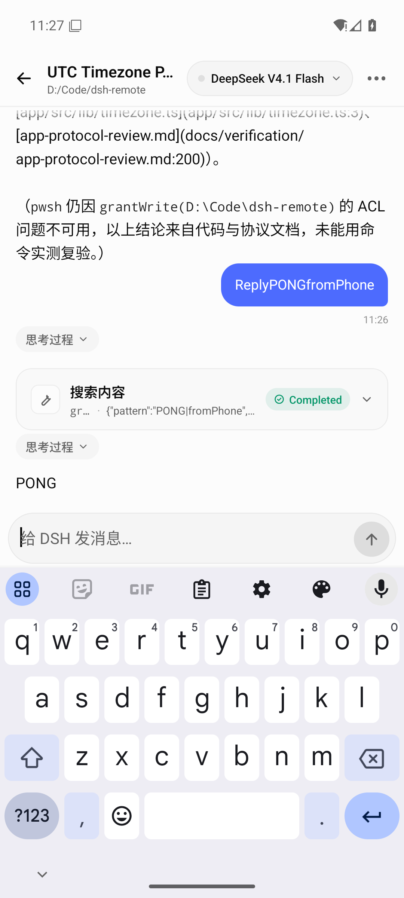
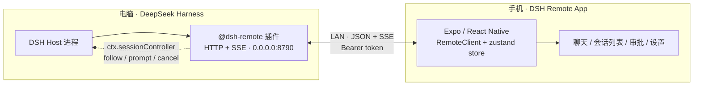
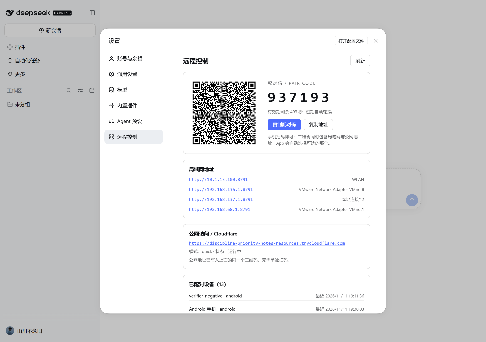

# DSH Remote · 手机直连你的 DeepSeek Harness

<div align="center">

<picture>
  <source media="(prefers-color-scheme: dark)" srcset="app/assets/images/deepseek-whale-white.png" />
  
</picture>
<br/>
<picture>
  <source media="(prefers-color-scheme: dark)" srcset="app/assets/images/deepseek-wordmark-white.png" />
  
</picture>

**用手机继续电脑上的 DeepSeek Harness 会话 —— 局域网直连，不经过云端。**

[](https://github.com/shanchuann/dsh-remote-)
[]()
[]()
[](docs/protocol.md)
[](https://www.npmjs.com/package/dsh-remote-harness)
[](LICENSE)

[功能](#功能) · [截图](#截图) · [架构](#架构) · [快速开始](#快速开始) · [npm 包](#npm-包) · [协议](#协议-v1) · [验证](#验证结果) · [开发](#开发)

</div>

---

**DSH Remote** 由两部分组成：

| 组件 | 说明 |
|---|---|
| **Host 插件**（[`plugin/`](plugin/)） | 跑在 DeepSeek Harness 进程内，暴露局域网 HTTP + SSE；调用 DSH 的 `sessionController`，转发会话、流式输出、工具调用、审批与模型选择。**零运行时依赖**（只用 `node:` 内置 + 一个 vendored QR 编码器）。 |
| **Android App**（[`app/`](app/)） | React Native（Expo SDK 58）+ [beUI Native](https://beui.dev) 组件；扫码/手动配对、会话列表、流式聊天、工具卡、审批、模型切换、断线重连。图标与文字标识来自 [`deepseek-whale.png`](app/assets/images/deepseek-whale.png) / [`deepseek-wordmark.png`](app/assets/images/deepseek-wordmark.png)（[`deepseek.svg`](deepseek.svg) 为原始矢量）。 |

> 所有流量只走你的局域网：手机 → 电脑 `LAN:8790`。没有中转服务器，没有账号体系，会话与凭据都留在本机。

## 功能

<table>
<tr>
<td width="50%" valign="top">

**连接**
- 二维码扫码配对 / 手动 IP + 6 位配对码
- 设备 token 持久化，App 重启自动恢复连接
- 每台手机独立 token，可在设置页单独撤销
- 断线指数退避重连，重连后自动重新订阅当前会话

**会话**
- 最近会话列表（标题、时间、运行状态、工作目录）
- 打开会话即加载历史快照，自动跟随新消息
- 新建会话、重命名、切换模型（含 reasoning effort）

</td>
<td width="50%" valign="top">

**聊天**
- token 级流式回复、思考过程折叠
- 工具调用卡片（参数/结果/状态，代码块高亮，长输出折叠）
- Todo 清单、Markdown、运行中停止按钮
- 键盘弹出时输入框自动上抬，不遮挡消息

**安全 / 体验**
- 本地审批：手机端审批卡（无人应答自动回退桌面端）
- 局域网明文 HTTP，仅限可信 Wi-Fi
- 深色 / 浅色主题，品牌蓝 `#4D6BFE`

</td>
</tr>
</table>

## 截图

<table>
<tr>
<td></td>
<td></td>
<td></td>
</tr>
<tr>
<td align="center"><sub>连接页 · 黑色鲸鱼标识</sub></td>
<td align="center"><sub>键盘弹出，输入区自动上抬</sub></td>
<td align="center"><sub>工具调用 + 流式回复（PONG）</sub></td>
</tr>
</table>

## 架构



- **Host 插件**在 DSH 进程内直接调用 `ctx.sessionController`（与官方 Web 客户端同一套业务逻辑），再用自定义的窄协议暴露给手机；不依赖 DSH 的生成式 Typert RPC。
- **App** 只依赖 HTTP/JSON + SSE（[协议 v1](docs/protocol.md)），用 zustand 管理连接/会话/流式/审批状态。
- 详细设计见 [docs/architecture.md](docs/architecture.md)；协议含真实抓包（[§9](docs/protocol.md)）。

## 快速开始

### 1. 安装 Host 插件

**方式 A · 在 DSH 桌面里点一下（推荐，无需脚本）**

打开 DSH → **插件 → 添加插件**，输入 `dsh-remote-harness` 安装即可。插件声明了 `dsh.bundle`，会作为一个 profile 组合包安装并在每次启动 DSH 时自动加载。

安装完成、重启 DSH 后：打开 **设置 → 远程控制**，即可看到配对二维码、配对码（自动轮换/倒计时）、局域网地址、公网地址与已配对设备（每 4 秒自动刷新）。也可直接访问 <http://127.0.0.1:8790/pair>。

**方式 B · 命令行安装**（等价）：

```bash
dsh plugin --profile desktop add dsh-remote-harness
```

**方式 C · 一键脚本**（适合本地开发，把插件复制到 `~/.dsh/plugins/dsh-remote`）：

```powershell
node plugin/scripts/install.mjs --dry-run
node plugin/scripts/install.mjs --yes
# 卸载：node plugin/scripts/uninstall.mjs --yes
```

> 不要同时使用 B/C：两种方式都会插入 `dsh-remote` 行，重复 id 会冲突。切换到 GUI/npm 方式前先运行 `uninstall.mjs --yes` 移除脚本安装。

重启 DSH（或等待配置热加载）后：

- 日志出现 `dsh remote: http://<局域网IP>:8790 (pair code 123456)`
- 配对信息写入 `~/.dsh/plugins/dsh-remote/pairing.json`、`pairing.png`、`pairing.txt`
- 电脑浏览器打开 **<http://127.0.0.1:8790/pair>** 查看二维码与配对码

> 端口默认 **8790**，可在 profile patch 的 `config.port` 修改；Windows 首次运行需放行防火墙 TCP 8790。

### 2. 安装 Android App

```bash
cd app
npx expo prebuild --platform android --clean
cd android && ./gradlew assembleRelease
# 产物：app/build/outputs/apk/release/app-release.apk
```

或直接下载已构建的 release APK：[GitHub Releases](https://github.com/shanchuann/dsh-remote-/releases)（v0.1.0 附带 `dsh-remote-0.1.0-release.apk`）。

环境：Node 20+、JDK 17+、Android SDK（platform 36 / build-tools 36）。Windows 下有两个已知构建坑，见 [docs/build-android.md](docs/build-android.md)。

### 3. 连接

1. 手机与电脑连同一个 Wi-Fi；
2. 打开 App → 扫描电脑 `/pair` 页面二维码（或手动填 `http://<电脑IP>:8790` + 6 位配对码）；
3. 选择会话，开始聊天；手机端可审批工具调用、切换模型、停止生成。

## npm 包

插件已发布到 npm：**[`dsh-remote-harness`](https://www.npmjs.com/package/dsh-remote-harness)**（v0.1.0）。

```bash
npm view dsh-remote-harness        # 查看版本
npm pack plugin                    # 打包 tarball（无需登录）
npm publish plugin --dry-run       # 发布前检查（无需登录）
```

发布（需要 npm 账号）：

```bash
npm login
npm publish plugin --access public
```

包内容：`src/`（Cordis 插件入口、bridge、net/auth/pairing）、`scripts/`（安装/卸载/配对 CLI）、`vendor/qrcode`、README。安装后可直接被 DSH profile 以包名加载；也可继续用 `file://` 本地路径方式。

## 协议 v1

HTTP/1.1 + JSON + Server-Sent Events，无 WebSocket、无第三方运行时依赖。

| 能力 | 端点 |
|---|---|
| 配对 | `POST /v1/pair`（6 位码，10 分钟 TTL，成功轮换） |
| 设备 | `GET /v1/devices` · `DELETE /v1/devices/:id` |
| 会话 | `GET /v1/sessions` · `POST /v1/sessions` · `GET /v1/sessions/:id` · `GET /v1/sessions/:id/history` |
| 实时 | `POST /v1/sessions/:id/open` → `GET /v1/events`（SSE：snapshot / event / assistant / state / approval） |
| 对话 | `POST /v1/sessions/:id/prompt` · `POST /v1/sessions/:id/cancel` · `POST /v1/sessions/:id/rename` |
| 模型 | `GET /v1/models` · `POST /v1/sessions/:id/model` |
| 审批 | `GET /v1/approvals` · `POST /v1/approvals/:id` |

完整字段、错误码与真实抓包见 [docs/protocol.md](docs/protocol.md)。

## 仓库结构

```text
dsh-remote-/
├── plugin/                 DSH Host 插件（可独立发布为 npm 包）
│   ├── src/
│   │   ├── dsh/bridge.mjs  ← 唯一接触 DSH 内部服务的文件
│   │   ├── net/            HTTP 路由 / SSE hub / 协议服务层
│   │   ├── auth/           配对码与设备 token（仅存 SHA-256）
│   │   ├── pairing/        二维码、/pair 页面、pairing 文件
│   │   └── state/          配置、DSH_HOME 解析、原子写
│   ├── scripts/            install / uninstall / pair-cli
│   └── test/               80 个单测（node:test）
├── app/                    Expo React Native 客户端
│   ├── src/app/            Expo Router 路由（连接/列表/聊天/设置）
│   ├── src/lib/            协议类型、HTTP+SSE 客户端、zustand store
│   ├── src/components/     beUI Native 组件 + chat 组件
│   └── app.json            图标 / 包名 / cleartext / 插件配置
├── docs/                   协议、架构、构建、验证报告与截图
├── tools/                  验证工具（独立协议客户端 / mock / e2e / APK 校验）
├── dist/                   已构建 APK（git 忽略，见 Releases）
├── deepseek.svg            品牌原始矢量（鲸鱼 + 文字）
└── deepseek-text.svg
```

## 开发

```bash
# Host 插件：80 个单测
node plugin/test/run-all.mjs

# App：类型检查 / lint / 单测 / 打包冒烟
cd app
npx tsc --noEmit
npx expo lint
node --test src/lib/__tests__/*.test.ts src/lib/__tests__/*.test.mjs
npx expo export --platform android --output-dir dist-export --clear

# 独立协议客户端（黑盒验证）
node tools/verify/mock-server.mjs --port 8790
node tools/verify/protocol-client.mjs --url http://127.0.0.1:8790 --code 123456 smoke
```

本机 Node 访问外网需代理时：`$env:HTTPS_PROXY='http://127.0.0.1:7890'; $env:NODE_USE_ENV_PROXY='1'`。

## 验证结果

真实 DSH **0.2.2-rc.1** 宿主 + Android 13 模拟器实测（非 mock）：

| 项目 | 结果 | 证据 |
|---|---|---|
| 插件单测 | **80 / 80**（连跑 3 次稳定） | `node plugin/test/run-all.mjs` |
| 真实宿主 e2e | **24 / 24 PASS**（流式帧、取消、重连快照、rename、history、设备撤销） | [e2e-report.md](docs/verification/e2e-report.md) |
| 真实宿主负向 | **36 PASS / 0 FAIL**（未知会话 404、非法时区 400、重复 requestId、配对锁定、26 MB body 413…） | [negative-real-host.md](docs/verification/negative-real-host.md) |
| App 质量门 | `tsc` 0 error、`expo lint` 0 problem、单测 **94 / 94**、`expo export` 成功 | [app-build-report.md](docs/verification/app-build-report.md) |
| APK | 包名 `dev.dsh.remote`、cleartext、arm64-v8a + x86_64、图标校验通过 | [app-build-report.md](docs/verification/app-build-report.md) |
| 模拟器全链路 | 配对 → 会话 → 历史 → 发送 → 工具卡/流式 → 停止 → **PONG** | [app-emulator-report.md](docs/verification/app-emulator-report.md) |

## 远程访问（公网）

插件 **0.1.3** 起内置 Cloudflare Tunnel：

```yaml
- id: dsh-remote
  config:
    port: 8790
    cloudflare:
      enabled: true
      mode: quick          # 随机 https://xxx.trycloudflare.com；长期用 named + token + hostname
```

配对页仍只有一个二维码：二维码里同时写入局域网地址和公网地址（`alt`），手机 App 先试局域网、失败自动切公网，同一个配对码两条路径都可用。页面上的「公网访问」卡片只用于展示地址和隧道状态。也支持 `publicUrl` 静态地址（Caddy/Nginx/frp），或直接用 Tailscale 组网。详见 [docs/remote-access.md](docs/remote-access.md)。

<p align="center"></p>


## 安全

- 仅监听局域网；配对码一次性、10 分钟 TTL、连续失败锁定；
- 设备 token 只存 SHA-256，可单独撤销；
- `/pair` 页面仅 loopback 可访问；
- **明文 HTTP，仅限可信 Wi-Fi**；不要直接暴露到公网，如需公网请自行加 TLS 反向代理；
- 插件在 DSH 进程内运行，拥有与本机 DSH 相同权限，只安装可信来源的包。

## 已知限制 / Roadmap

- [ ] v1 仅文本输入（协议已预留图片 content blocks）
- [ ] `ask_user_question` 的手机端回答面板（工具审批已支持）
- [ ] 会话搜索、子 Agent 视图
- [ ] 推送通知（审批 / 完成）
- [ ] PWA 版（复用同一协议）
- [ ] 内置 TLS / 反向代理辅助

## 协议 / 文档索引

- [docs/protocol.md](docs/protocol.md) — 移动协议 v1（含真实抓包）
- [docs/architecture.md](docs/architecture.md) — 系统设计
- [docs/build-android.md](docs/build-android.md) — 构建 APK（含 Windows 坑）
- [docs/app-architecture.md](docs/app-architecture.md) — App 模块边界与 store 契约
- [docs/publishing-npm.md](docs/publishing-npm.md) — 发布 `dsh-remote-harness` 到 npm（含 Actions）
- [docs/remote-access.md](docs/remote-access.md) — 公网访问：Cloudflare Tunnel / Caddy / Tailscale
- [docs/verification/README.md](docs/verification/README.md) — 验证索引

## License

[MIT](LICENSE) © shanchuann

<sub>DeepSeek Harness 是 DeepSeek 的产品；本仓库是非官方的社区远程访问方案。DeepSeek 鲸鱼图标与文字标识来自仓库内 [deepseek-whale.png](app/assets/images/deepseek-whale.png) / [deepseek-wordmark.png](app/assets/images/deepseek-wordmark.png)。</sub>