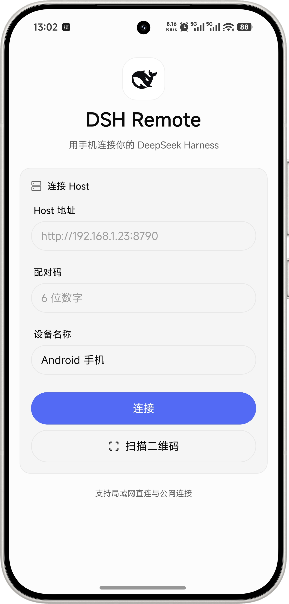
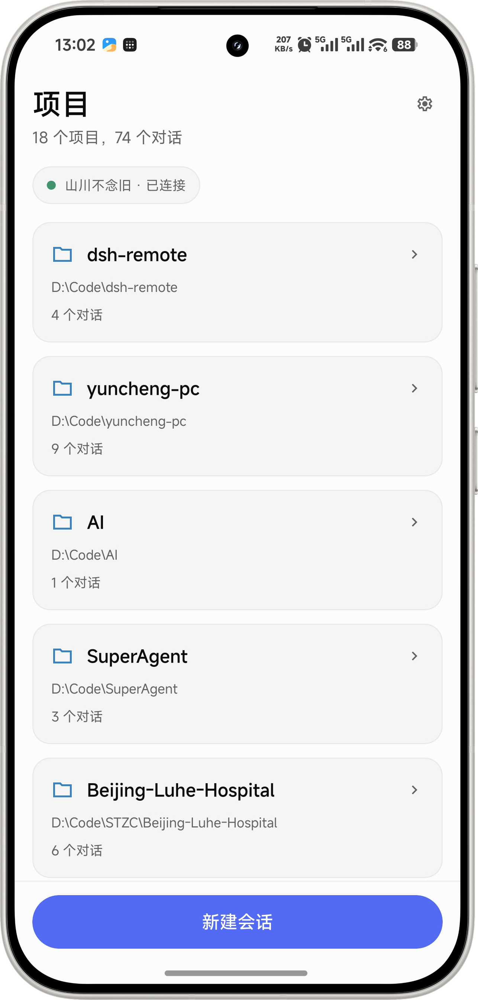
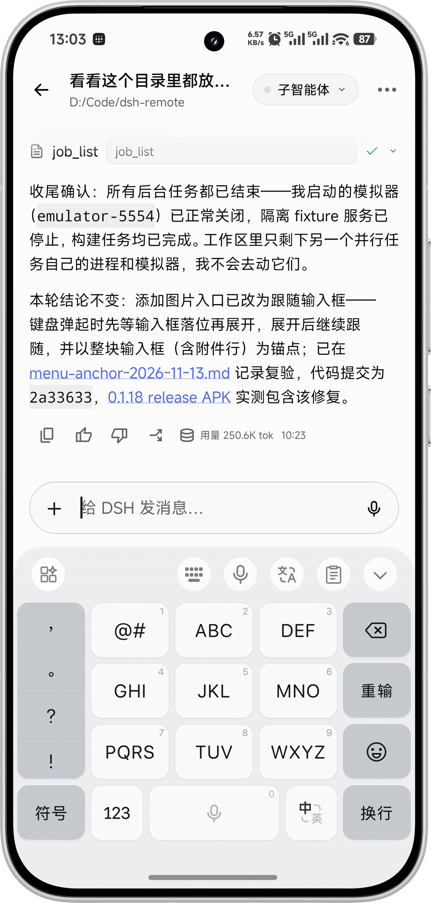
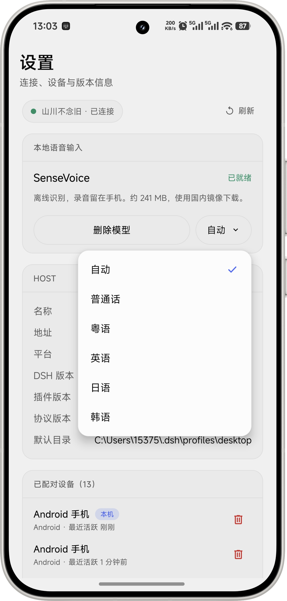
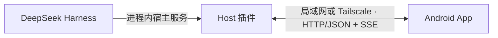

# DSH Remote

<div align="center">

<picture>
  <source media="(prefers-color-scheme: dark)" srcset="app/assets/images/deepseek-whale-white.png" />
  
</picture>

通过 Android 手机访问电脑上正在运行的 DeepSeek Harness，查看项目、继续会话并处理工具审批。支持局域网直连与 Tailscale 远程连接。

[](https://www.npmjs.com/package/dsh-remote-harness)
[](https://github.com/shanchuann/dsh-remote/releases/latest)
[](docs/protocol.md)
[](LICENSE)

</div>

## 界面示例

以下为 Android 实机界面，依次展示连接、项目列表、对话输入和本地语音设置。图片由用户于 2026-11-13 提供；其中的项目名称、路径和会话内容仅为使用示例。

<table>
  <tr>
    <td width="25%"></td>
    <td width="25%"></td>
    <td width="25%"></td>
    <td width="25%"></td>
  </tr>
  <tr>
    <td align="center">连接与配对</td>
    <td align="center">项目与会话</td>
    <td align="center">对话输入</td>
    <td align="center">本地语音设置</td>
  </tr>
</table>

图中连接页的“公网连接”为旧版界面文案；当前远程访问使用 Tailscale。各页面的操作说明见[界面示例](docs/screenshots.md)。

## 功能与组成

DSH Remote 由 [Host 插件](plugin/)和 [Android App](app/)组成。插件运行在 DSH 进程内，调用 `sessionController` 等宿主服务，通过 HTTP/JSON 和 SSE 向手机提供接口。App 使用 React Native、Expo SDK 58 和 beUI Native 构建。

- 按项目浏览主会话，在对话页查看子智能体；支持新建会话、重命名及模型切换。
- 查看历史消息、流式回复、思考过程和工具结果；支持任务面板、文件改动与交付图片预览。
- 发送文字和图片，或使用 Android 本地语音识别生成可编辑的文字草稿。
- 在手机上批准或拒绝工具请求，停止正在生成的回复；断线后自动重连并重新订阅当前会话。
- 使用六位配对码添加设备，每台设备独立认证，可在设置中撤销访问。

会话和工作目录由电脑上的 DSH 管理，手机保存连接信息与设备凭据。电脑需要保持运行。

## 安装与连接

### 安装 Host 插件

打开 DSH 桌面端的“插件 → 添加插件 → 安装第三方插件”，输入 `dsh-remote-harness`，使用 npm 官方源安装。启用后，进入“设置 → 远程控制”查看连接地址、二维码、配对码和已配对设备。也可在电脑浏览器访问 <http://127.0.0.1:8790/pair>。

通过 npm 包名安装后，DSH 插件页可以检测后续版本并提供更新入口。本地 `.tgz`、`file:` 或脚本复制方式安装的插件不参与 npm 更新检测。

Tailscale 支持从 Host 插件 0.1.16 起提供。安装前可核对官方源版本：

```bash
npm view dsh-remote-harness version --registry https://registry.npmjs.org/
```

如果 registry 尚未提供所需版本，可在仓库根目录打包：

```bash
npm pack ./plugin --pack-destination ./dist
```

在同一桌面安装入口填写生成的 `.tgz` 绝对路径。Electron 管理的 `desktop` profile 应通过桌面插件页安装；`dsh plugin --profile desktop add ...` 无法修改该 profile。支持热加载时安装后会生效，否则按 DSH 提示重启。发布及安装来源迁移见 [npm 发布说明](docs/publishing-npm.md)。

### 安装 Android App

已公开的 APK 见 [GitHub Releases](https://github.com/shanchuann/dsh-remote/releases/latest)。Release 附件与本地源码可能处于不同版本，请以对应发布说明为准。需要自行构建时，参见 [Android 构建说明](docs/build-android.md)。

### 局域网连接

1. 手机和电脑接入同一局域网，确认电脑防火墙允许访问 TCP 8790。
2. 在 App 中扫描电脑配对页的二维码，或输入 `http://<电脑局域网 IP>:8790` 和当前六位配对码。
3. 连接成功后，选择项目和会话。

### Tailscale 远程连接

1. 电脑和手机安装 [Tailscale](https://tailscale.com/download)，加入同一 tailnet，并保持已连接。
2. 打开电脑上的“设置 → 远程控制”。插件会识别 Tailscale IPv4 网卡，并优先将该地址写入二维码，同时提供局域网备用地址。
3. 手机扫描二维码，或输入 `http://<电脑的 Tailscale IPv4>:8790` 和配对码。

直接使用 IP 地址不依赖 Tailscale DNS。浏览器能访问 Host、App 却超时时，应检查 App 中保存的地址和 Tailscale 应用分流设置。完整排查步骤及旧 Cloudflare 配置迁移见[远程访问说明](docs/remote-access.md)。

## 本地语音输入

在“设置 → 本地语音输入”下载并校验约 241 MB 的 SenseVoice 模型，可选择官方源或国内镜像。模型就绪后，点击对话输入框的麦克风录音，识别结果填入草稿，确认后再发送。

语音识别使用 SenseVoiceSmall INT8、Silero VAD 和 sherpa-onnx，在手机 CPU 上运行，录音不上传。支持自动检测、普通话、粤语、英语、日语和韩语，单次录音最多 90 秒。离开应用或切换会话会取消当前语音输入。

## 架构与协议



Host 插件使用 Node.js 内置模块和随包提供的 QR 编码器，无第三方运行时 npm 依赖。远程连接由系统 Tailscale 客户端提供，插件不启动 VPN 或公网隧道进程。

协议 v1 覆盖配对、设备、项目与会话、消息、模型和审批。详细字段、事件及错误码见[协议文档](docs/protocol.md)，模块划分见[系统架构](docs/architecture.md)和 [App 架构](docs/app-architecture.md)。

## 开发与验证

```bash
# Host 插件测试
node plugin/test/run-all.mjs

# App 依赖与检查
npm --prefix app ci
npm --prefix app run typecheck
npm --prefix app run lint
npm --prefix app test
```

原生语音依赖由 `npm --prefix app run voice:prepare` 下载并校验。APK 构建流程、Windows 环境问题及签名说明见 [Android 构建说明](docs/build-android.md)。

[验证记录索引](docs/verification/README.md)按日期记录检查对象和结果。界面示例用于说明操作；不同版本的历史报告不作为当前全部功能已通过验收的结论。

```text
dsh-remote/
├── plugin/       Host 插件、桌面设置页、安装脚本和测试
├── app/          Android App、协议客户端及本地语音模块
├── docs/         架构、协议、构建、示例图片和验证记录
├── tools/        构建、资源处理及独立协议验证工具
└── dist/         本地构建产物，公开安装包通过 Releases 分发
```

## 访问控制与限制

插件默认监听 `0.0.0.0:8790`。配对码有效期为十分钟，成功配对后轮换，连续失败会锁定；设备 token 在 Host 侧仅保存 SHA-256 摘要，可逐台撤销。配对页面仅允许本机访问。

局域网 HTTP 适用于可信网络，远程流量通过 Tailscale 加密传输。不要将 8790 端口直接映射到公网。插件在 DSH 进程内运行，安装来源应可信。

手机端尚未提供 `ask_user_question` 回答面板、会话搜索、推送通知、完整文件编辑与 Git 操作。自动化配置和插件管理仍在桌面端完成。

## 文档

| 文档 | 内容 |
|---|---|
| [界面示例](docs/screenshots.md) | 四个主要页面及操作说明 |
| [远程访问](docs/remote-access.md) | Tailscale、旧配置迁移与连接排查 |
| [npm 发布](docs/publishing-npm.md) | 发布、认证和 DSH 插件页更新 |
| [系统架构](docs/architecture.md) | Host 桥接、网络服务与访问控制 |
| [App 架构](docs/app-architecture.md) | 客户端模块与状态管理 |
| [协议 v1](docs/protocol.md) | HTTP 接口、SSE 事件与抓包记录 |
| [Android 构建](docs/build-android.md) | 环境、构建命令与本机问题记录 |
| [验证记录](docs/verification/README.md) | 各版本的检查范围与证据 |

## 许可证

[MIT](LICENSE) © shanchuann。DSH Remote 是社区项目，非 DeepSeek 官方产品。DeepSeek 图标与文字标识来自仓库内的品牌资源。
