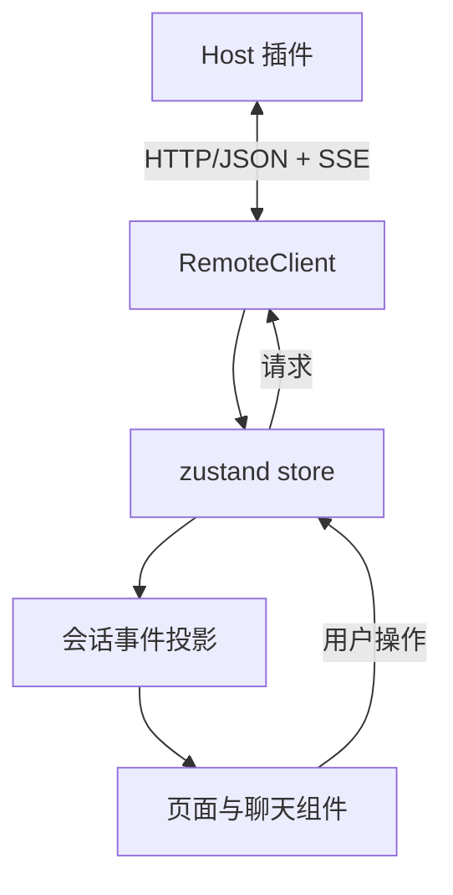

# Android App 架构

App 使用 Expo SDK 58、React Native 0.88、TypeScript 和 Expo Router。界面由 beUI Native 组件及聊天组件构成，通过 HTTP/JSON 和 SSE 访问 Host 插件。界面示例见[页面说明](screenshots.md)，通信字段见[协议 v1](protocol.md)。

## 模块划分

| 模块 | 职责 |
|---|---|
| `src/app/` | 连接、项目与会话列表、对话、设置等路由页面 |
| `src/lib/client.ts` | HTTP 请求、认证、SSE 连接与事件分发 |
| `src/lib/store.ts` | 连接生命周期、项目与会话状态、快照和增量事件、审批与模型操作 |
| `src/lib/pairing.ts` | Host 地址校验、二维码负载解析及配对信息 |
| `src/lib/types.ts` | HTTP 响应、SSE 载荷和功能能力声明 |
| `src/lib/transcript.ts` | 将会话事件与流式片段转换为界面渲染项 |
| `src/lib/voice.ts` | 本地语音模型状态、识别流程和语言选择 |
| `src/components/chat/` | 消息、工具结果、任务面板、文件预览、输入与模型选择 |
| `src/components/common/` | 图标、连接状态及通用界面组件 |
| `modules/dsh-voice/` | Android 本地语音与原生交互模块 |

## 数据流



`RemoteClient` 负责传输和事件分发，`useRemoteStore` 负责应用状态与连接生命周期。聊天组件从事件投影读取消息、工具调用和任务状态，页面不直接拼接协议请求。

## 连接与持久化

App 支持手动填写 Host 地址或扫描二维码。二维码可包含主地址和备用地址；检测到 Tailscale 时，Host 优先提供 Tailscale IPv4。网络配置及排查见[远程访问](remote-access.md)。

设备 token 保存在 SecureStore，地址与设备显示信息保存在本地持久化存储中。App 启动时恢复已保存的连接，SSE 断开后按重连策略恢复；连接恢复后，重新打开当前会话订阅。

认证失效时应进入重新配对流程。切换 Host 或会话后，旧订阅和迟到的响应不能覆盖当前页面状态。

## 会话与事件

打开会话后，Host 发送快照及后续事件：

- 快照替换当前事件集，同时恢复标题、模型、任务和流式状态。
- 增量事件按序列号去重后追加，历史分页使用服务端返回的边界。
- 流式文本显示为临时回复，收到最终消息后与持久化记录合并。
- 发送消息时显示带请求标识的本地待确认项，收到宿主确认后去重。

`transcript.ts` 负责事件投影，应保持可独立测试。用户消息、助手回复、工具调用与结果按各自标识关联，内部注入消息按来源过滤。文件改动依据宿主保存的快照展示，不能用当前文件内容代替缺失的历史快照。

## 输入与本地语音

对话输入支持文字、图片和语音转文字。语音模型由用户在设置中下载并校验，通过 sherpa-onnx 在 Android 本地运行，识别结果先写入草稿，由用户确认后发送。

键盘出现时，输入区保持在键盘上方。任务面板使用独立滚动边界；输入时可收起为摘要，键盘关闭后恢复。输入菜单的位置依赖输入区完成布局后的实际边界，相关记录见[菜单定位验证](verification/menu-anchor-2026-11-13.md)。

## 界面约定

页面随系统切换浅色和深色主题，颜色使用主题 token。交互组件需处理系统安全区、软键盘、长文本及工具输出折叠。较长的消息列表、任务列表和文件内容分别管理滚动边界，避免输入区遮挡内容。

模型选择、工具审批和会话操作由 store 调用客户端完成。功能是否可用应参考 Host 的能力声明，不能仅依据 App 版本判断。

## 开发检查

在仓库根目录运行：

```bash
npm --prefix app ci
npm --prefix app run typecheck
npm --prefix app run lint
npm --prefix app test
```

依赖安装需与当前 Expo SDK 兼容；涉及原生配置时，更新 `app.json`、Expo 配置插件或本地原生模块，再重新生成 Android 工程。不要仅修改生成目录作为持久修复。

APK 构建和原生语音依赖准备见 [Android 构建说明](build-android.md)。验证时需区分静态检查、隔离宿主测试、模拟器检查和实机结果，分别记录版本及检查范围。
