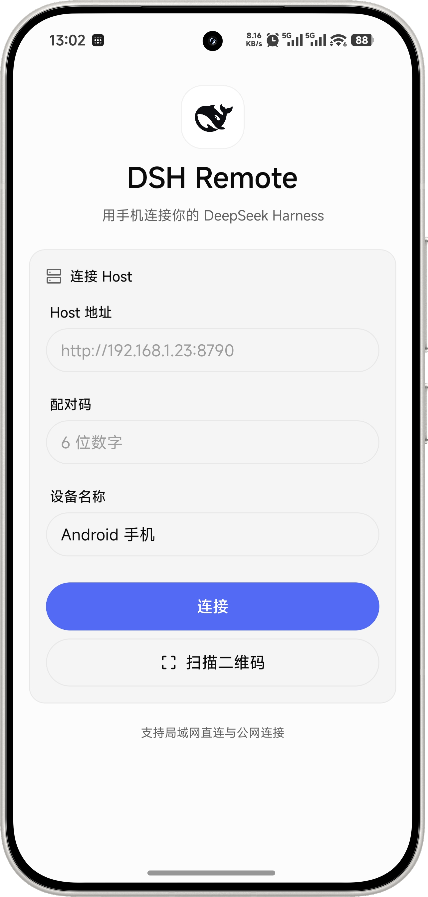

# 远程访问：Tailscale

DSH Remote 通过局域网直连或 Tailscale 访问电脑上的 DSH。远程访问使用 Tailscale，插件不再管理 Cloudflare 隧道或静态公网地址。

## 首次连接

1. 电脑和手机都安装 [Tailscale](https://tailscale.com/download)，加入同一 tailnet，确认两端处于 Connected。tailnet 的访问策略需允许手机访问电脑的 TCP 8790。
2. 保持电脑上的 DSH 运行，安装本项目新版 Host 插件。默认监听 `0.0.0.0:8790`，同时接受局域网和 Tailscale 网卡请求。
3. 打开 **DSH → 设置 → 远程控制**，或在电脑访问 <http://127.0.0.1:8790/pair>。
4. 页面显示电脑的 Tailscale 地址。二维码优先使用 Tailscale 地址，并携带可识别的物理局域网备用地址；手机先尝试主地址，主地址连接失败后再尝试备用地址。
5. 手机保持 Tailscale 已连接，打开 DSH Remote 扫码。也可手动填写 `http://<电脑的 Tailscale IPv4>:8790` 和页面上的当前六位配对码。Host 地址只填到端口，不加 `/pair` 或 `/v1/health`。
6. 关闭手机 Wi-Fi，使用移动数据打开会话、发送消息，并确认流式回复与重连。

Windows 可用 `tailscale ip -4` 查看电脑地址；若命令不在 PATH，在 Tailscale 界面查看。不要填写手机自身的 Tailscale 地址。



图中“公网连接”为旧版界面文案。当前跨网络连接使用 Tailscale；更多页面见[界面示例](screenshots.md)。

插件从系统网卡读取地址，识别具有 `100.64.0.0/10` 地址、名称含 Tailscale 的网卡，以及符合该地址范围的 macOS `utunN` 网卡。其他 VPN 若共用此地址范围及网卡名称，需要核对实际归属。未检测到地址时，可在 App 手动填写电脑 Tailscale IPv4。插件不调用外部 CLI，也不预设某台电脑的 IP。

未安装 Tailscale 时仍可在同一 Wi-Fi 下用局域网地址连接。插件发现网卡不等同于证明手机到 Host 的端口可达。

## Host 配置

Tailscale 无需专门的插件配置，保留默认监听即可：

```yaml
- id: dsh-remote
  config:
    port: 8790
    host: "0.0.0.0"
```

不要绑定 `127.0.0.1`，否则手机无法访问。电脑防火墙应允许来自所需 Tailscale 设备的 TCP 8790 入站。无需路由器端口转发、公开域名或 Tailscale Funnel。

Tailscale 在系统层加密网络流量，插件仍使用 HTTP + JSON + SSE，配对码、独立设备 token 和 DSH 工具审批保持有效。

## 从旧公网隧道迁移

1. 从启用插件的 profile `cordis.patch.yml` 中删除 `cloudflare` 配置块和 `publicUrl`。
2. 安装 Host 插件 0.1.16 或后续版本。先确认 npm 官方源提供所需版本，再在“DSH → 插件 → 添加插件 → 安装第三方插件”中输入包名和版本。若尚未发布，可在仓库根目录运行 `npm pack ./plugin --pack-destination ./dist`，改用生成的 `.tgz` 绝对路径安装。Electron 管理的 `desktop` profile 应通过桌面插件页修改。支持热加载时安装后生效，否则按界面提示重启。残留旧配置不会再启动隧道或写入二维码。
3. 如果此前通过外部脚本或 Windows 服务启动过 cloudflared，需要停用对应脚本或服务；新版插件不会管理这些外部进程。
4. 手机打开 **设置 → 重新配对**，用电脑 Tailscale 地址和新配对码连接。App 已保存的旧公网地址不会自动改写。
5. 检查 `/v1/health` 中 `tailscaleUrl` 是否是电脑的地址；新版响应不再发布 `publicUrl` 或 `tunnel` 字段。

只修改仓库源码不会更新已经安装的插件或 APK。需按 README 的安装方式更新插件；手机连接能力兼容现有协议 v1，连接页提示变化需要新 App 构建。

离线安装不参与 DSH 的 npm 版本检测。发布后切换为 npm 包名安装，后续即可通过插件页更新，详见 [npm 发布与迁移](publishing-npm.md)。

## 连接超时排查

先在手机浏览器打开：

```text
http://<电脑的 Tailscale IPv4>:8790/v1/health
```

| 现象 | 检查方法 |
|---|---|
| 浏览器返回 `"ok": true`，App 超时 | 核对 App 使用相同的 IP、`http://` 和端口；通过重新配对替换旧地址，并检查 Tailscale 应用分流是否允许 DSH Remote 走 VPN。必要时关闭 App 后重新打开。 |
| 浏览器也超时 | 检查 DSH 是否运行、电脑是否休眠、Host 是否监听 8790，以及系统防火墙、Tailscale 入站开关和 tailnet 访问策略。设备在线不代表应用端口可达。 |
| 配对码错误或过期 | 在电脑页面读取当前配对码。配对成功后，原配对码失效。 |
| 不确定是否需要 DNS | 直接使用 Tailscale IP 时无需启用 DNS；使用 MagicDNS 设备名时才需要域名解析。 |
| 切换网络后断线 | 确认手机 Tailscale 保持连接后重试，App 会尝试恢复已保存地址的连接。 |

官方说明：[设备连接](https://tailscale.com/docs/how-to/connect-to-devices)、[Android App 分流](https://tailscale.com/docs/features/client/android-app-split-tunneling)。

## 访问管理

仅将可信设备加入 tailnet，按需限制 TCP 8790 访问，并在 DSH Remote 设置中撤销不用的设备。局域网 HTTP 仅用于可信网络，不要把 8790 暴露到公网。电脑仍需保持 DSH 运行，Tailscale 不替代应用的工具审批或设备认证。
