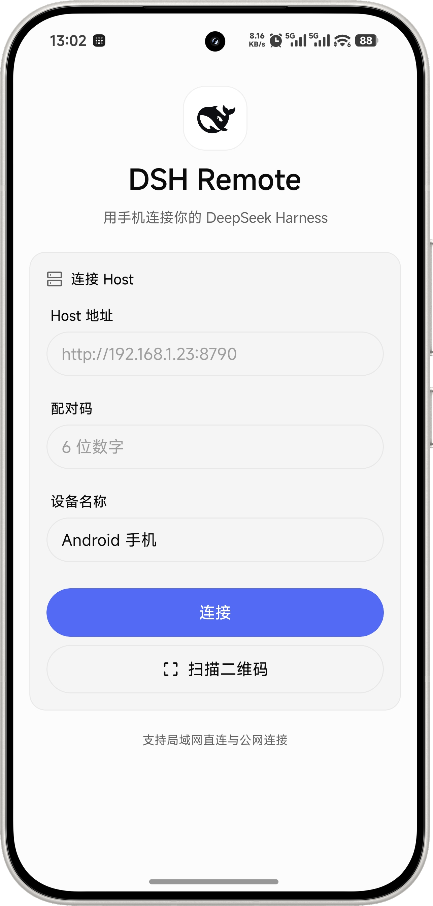
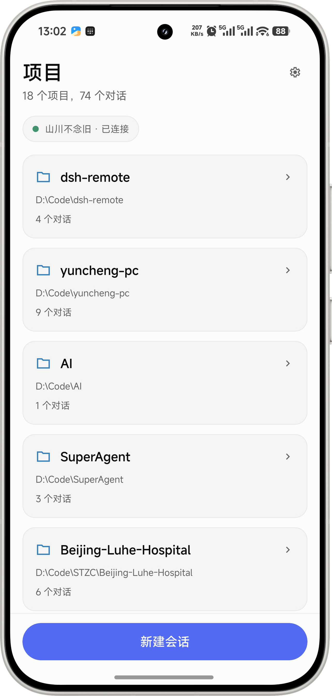
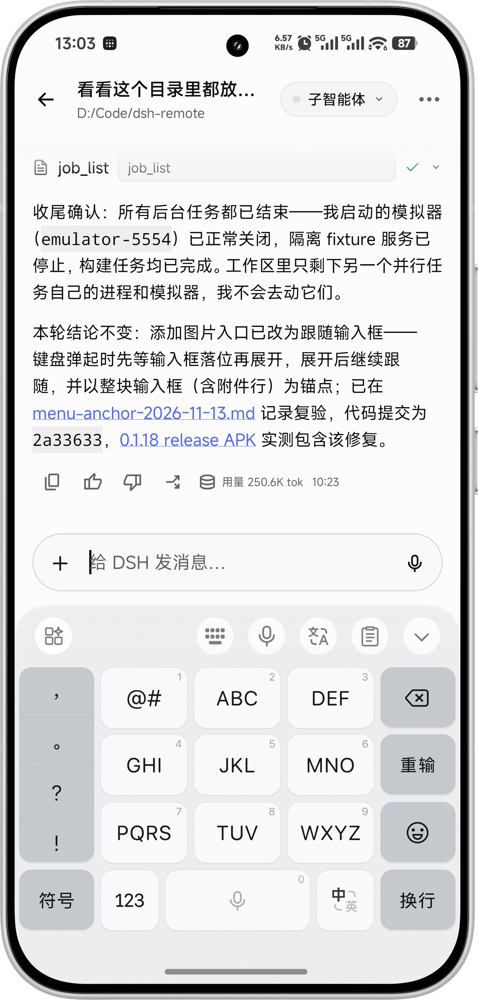
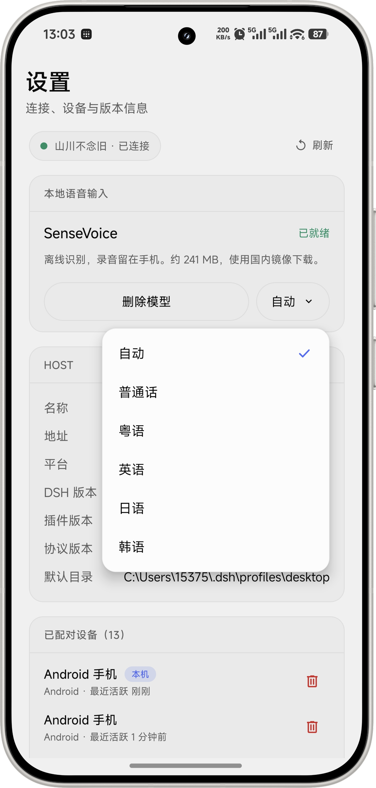

# Android 界面示例

本页使用用户于 2026-11-13 提供的四张 Android 实机截图，保留原图及手机边框。截图用于说明操作，未据此认定某一 APK 版本的全部功能已通过验收。图中的设备名称、项目路径和会话内容为实际使用示例，不是默认配置。

## 连接与配对

输入电脑的 Host 地址、当前六位配对码和设备名称，然后连接；也可扫描电脑“设置 → 远程控制”中的二维码。Host 地址只需填写到端口，例如 `http://<电脑 IP>:8790`。

图中的“支持局域网直连与公网连接”为旧版界面文案。当前跨网络访问使用 Tailscale：手机和电脑加入同一 tailnet，再使用电脑的 Tailscale IPv4。连接方式及排查步骤见[远程访问](remote-access.md)。

## 项目与会话

连接后，项目页按电脑上的工作目录组织主会话，并显示连接状态和会话数量。点击项目查看会话，底部入口用于新建会话。子智能体在对话页查看。

## 对话输入

对话页展示历史回复与工具执行结果，支持 Markdown、文件链接和代码内容。系统键盘展开时，输入框随键盘上移；可以继续输入、添加图片或开始语音输入。

截图中的会话正文属于示例内容，其中的提交号、测试结果及 APK 链接不作为本页的发布或验收结论。

## 本地语音设置

在设置中下载并校验 SenseVoice 模型后，可在对话页使用本地语音输入。识别语言支持自动检测、普通话、粤语、英语、日语和韩语。录音在手机上处理，识别结果填入草稿后由用户确认发送。

## 图片维护

GitHub README、本页和 npm README 共用 `docs/screenshots/` 中的四张图片。仓库文档使用相对路径，npm README 使用该仓库的公开原始图片地址；更新图片时需先将资源提交到 GitHub，再发布包含新 README 的 npm 版本。

历史测试截图保存在 `docs/verification/screenshots/`，与对应验证报告一起保留。不要用产品示例图覆盖旧测试证据。
