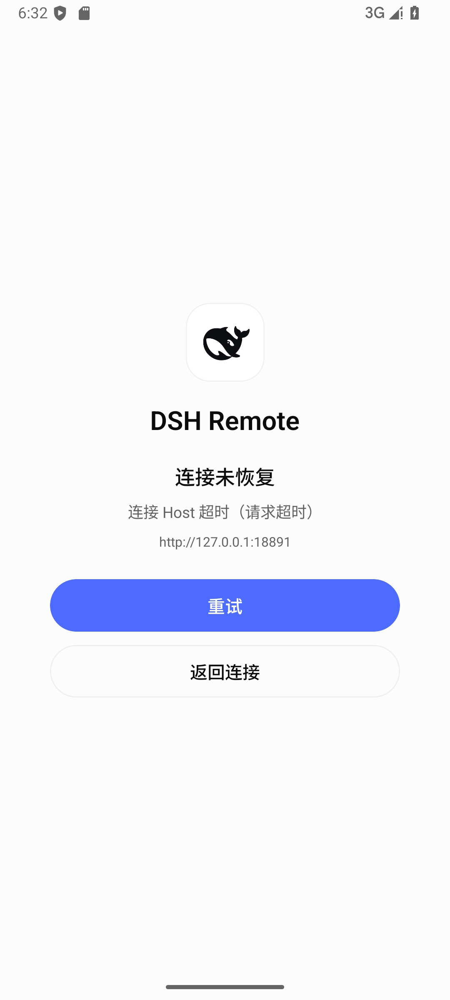
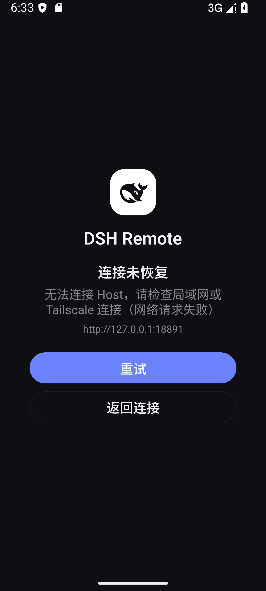
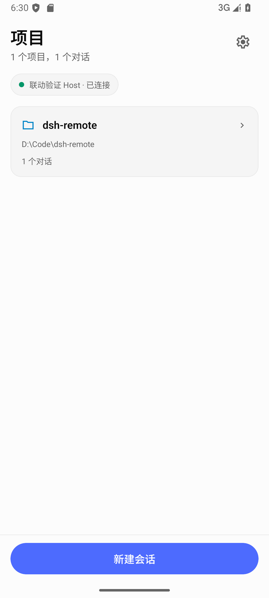
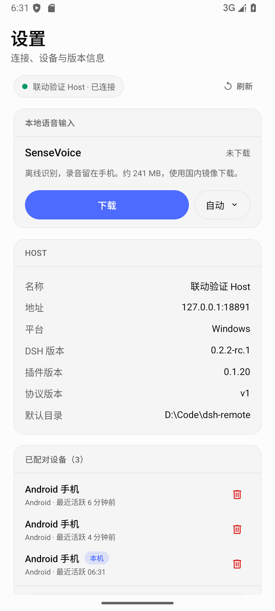

# Android 0.1.24 连接恢复与版本核对

## 版本与产物

App 版本为 0.1.24，Android versionCode 为 24。此前本地已有 0.1.22、0.1.23 安装包，GitHub 最新 Android Release 仍为 0.1.15，本次统一发布 0.1.24。

Host 插件维持 npm 0.1.17。App 的插件版本读取 `/v1/host`，不会固定为某个版本，也不会将 npm 最新版本误显示为电脑已安装版本。检查时实际桌面 Host 的 `/v1/health` 返回 0.1.16，说明电脑仍在运行旧版插件。

APK：`dist/dsh-remote-0.1.24-release.apk`，包含 arm64-v8a 和 x86_64。SHA-256：

```text
7796171766f69a367aa012884287d819e88ea1f4bfa79e88a88a1b85c2a1284f
```

签名证书与本地 0.1.22 一致，证书 SHA-256 为 `fac61745dc0903786fb9ede62a962b399f7348f0bb6f899b8332667591033b9c`。沿用现有 Android Debug 签名，便于覆盖安装。

## 本轮修复

- 已配对设备恢复失败后显示“重试”和“返回连接”。重试保留设备凭据，返回连接保留已填地址；首次安装直接显示配对表单。
- 合并启动与 Android 前台事件触发的重连，避免重复创建连接。
- 项目页设置图标从 16 调整为 24，按钮从 32 调整为 48 dp。
- 设置页进入时刷新 Host 信息；保持前台且页面可见时每 15 秒刷新，离开页面后停止。
- Host 与设备信息刷新忽略断开连接后返回的旧响应，避免旧数据重新出现。
- 配对失败只有网络错误或超时才尝试备用地址，配对码错误不重复提交。
- 移除设备失败向界面返回错误；网络错误提示兼顾局域网和 Tailscale。

当前工作区还包含 0.1.16 至 0.1.23 期间的聊天布局、消息操作、图标及原生文本引用等改动。本次 APK 使用当前完整 App 源码构建，相关源码一并提交，避免发布包与源码脱节。

## 自动检查

| 检查 | 结果 |
|---|---|
| App TypeScript | 通过 |
| Expo lint | 通过 |
| App 单元测试 | 153 / 153 通过 |
| 插件测试 | 102 / 102 通过 |
| APK 检查 | 19 / 19 通过 |
| Android 原生构建 | Gradle assembleRelease 成功；增量构建成功 |
| 本轮三个页面的设计静态检查 | 无发现 |

新增回归用例覆盖超时后重试、凭据保留、并发恢复、Host 版本更新、断开后的旧响应、设备移除错误，以及配对码错误与网络错误的备用地址策略。

## 模拟器验证

使用 Android API 35、1080 × 2400 的隔离模拟器与独立协议夹具，不修改用户桌面设备和会话。夹具 Host 版本由 0.1.19 改为 0.1.20，设置页无需点击刷新即更新，证明显示跟随 Host 响应。截图中的版本用于验证刷新行为，不代表 npm 发布版本。

超时夹具保持请求未返回，App 在请求期限后显示“重试 / 返回连接”。恢复夹具网络后点击“重试”直接进入项目页，无需重新输入配对码；再次模拟离线后点击“返回连接”，表单保留 `http://127.0.0.1:18891`。深色主题和 1.3 倍字体下按钮、提示与地址均可见。

额外的凭据失效界面测试被自动审批以 `blocked by policy` 拒绝，未提供具体原因；未继续执行该界面用例。凭据失效的 token 清除和重新配对状态由单元测试覆盖。









## 后续优化

1. Android Release 目前由本机构建和上传，npm OIDC 工作流只处理插件。后续可增加 Android 构建、校验和 Release 附件上传流程。
2. APK 仍沿用项目已有的 Debug 签名。正式分发应规划独立签名密钥与旧版升级迁移方案；不能直接更换签名后要求用户覆盖安装。
3. 电脑当前运行的插件为 0.1.16，可通过 DSH 插件页更新为 0.1.17；本轮未改动用户桌面 profile。

模拟器验证不代替小米实机上的 Tailscale 分流、电池限制和长时间后台恢复测试。本轮未重新下载完整语音模型或重复语音识别验收。
