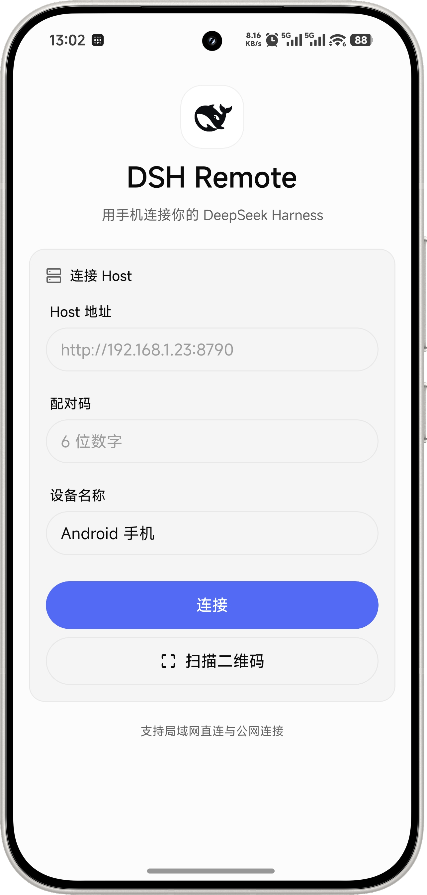
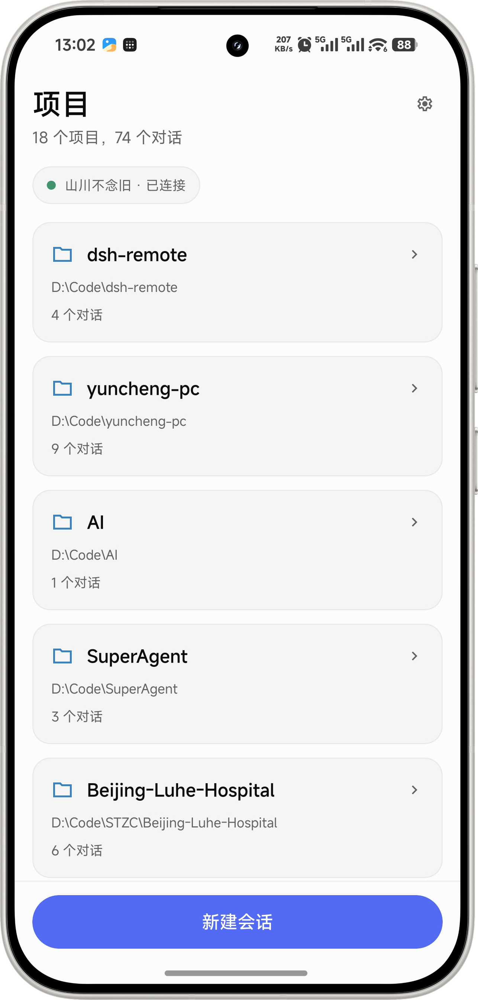
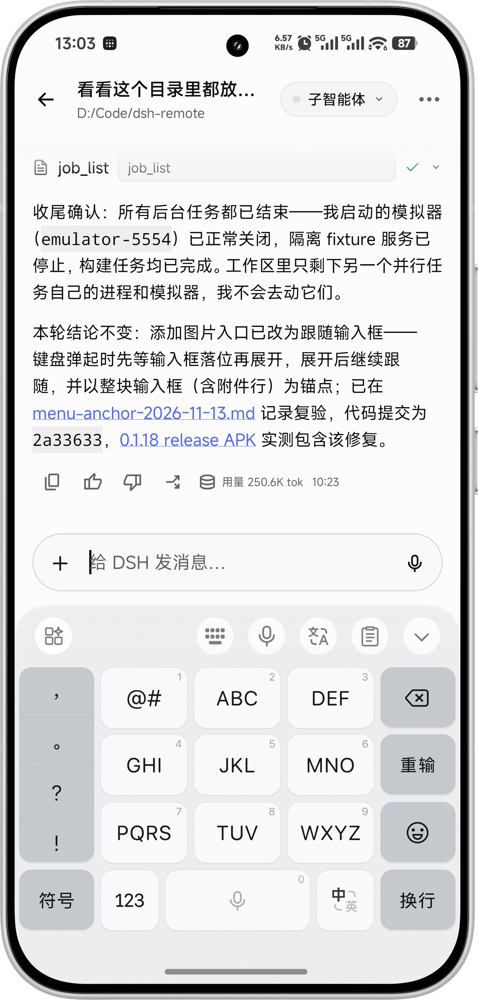
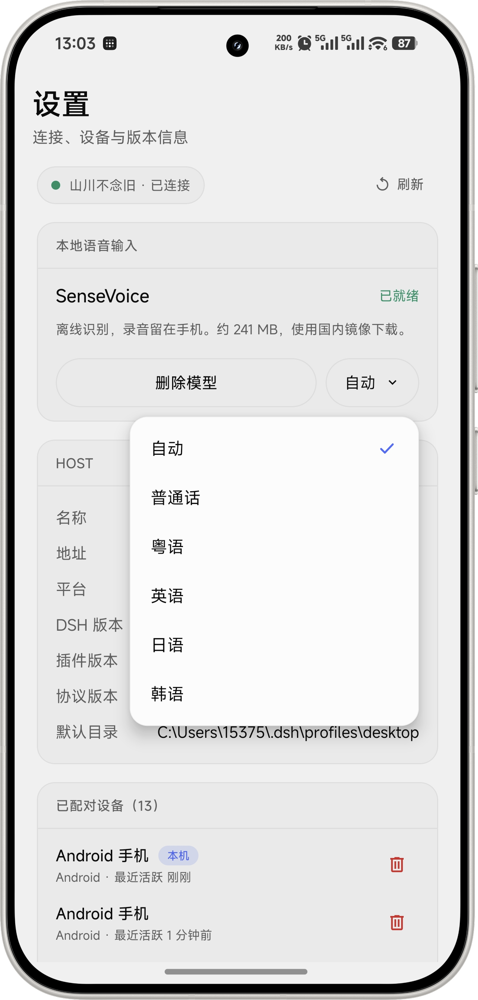

# dsh-remote-harness

`dsh-remote-harness` 是 [DSH Remote](https://github.com/shanchuann/dsh-remote) 的 Host 插件，运行在 DeepSeek Harness 进程内。Android App 通过局域网或 Tailscale 访问电脑上的项目与会话，接收流式回复、查看工具结果，并处理审批和模型切换。

插件使用 HTTP/JSON 和 SSE，依赖 Node.js 内置模块和随包提供的 QR 编码器，无第三方运行时 npm 依赖。

## 界面示例

以下为用户于 2026-11-13 提供的 Android 实机界面，分别展示连接、项目列表、对话输入和本地语音设置。项目名称、路径和会话内容为使用示例。

<table>
  <tr>
    <td width="25%"></td>
    <td width="25%"></td>
    <td width="25%"></td>
    <td width="25%"></td>
  </tr>
  <tr>
    <td align="center">连接与配对</td>
    <td align="center">项目与会话</td>
    <td align="center">对话输入</td>
    <td align="center">本地语音设置</td>
  </tr>
</table>

图中连接页的“公网连接”为旧版界面文案；当前远程访问使用 Tailscale。操作说明见[界面示例文档](https://github.com/shanchuann/dsh-remote/blob/main/docs/screenshots.md)。

## 安装与更新

在 DSH 桌面端打开“插件 → 添加插件 → 安装第三方插件”，输入 `dsh-remote-harness`，使用 npm 官方源安装并启用。插件声明了 `dsh.bundle` 和 `dsh.client`，启用后会在“设置 → 远程控制”显示二维码、配对码、连接地址和设备列表。

电脑浏览器也可访问 <http://127.0.0.1:8790/pair> 查看配对信息。

通过 npm 包名安装后，DSH 插件页会检测后续 npm 版本并提供更新入口。通过本地 `.tgz`、`file:`、`link:`、Git 或脚本复制方式安装的插件不参与 npm 更新检测。Electron 管理的 `desktop` profile 应使用桌面插件页安装与更新。

已有离线版本时，应先确认 npm 官方源包含所需版本，再在插件页以 `dsh-remote-harness@<版本号>` 安装，核对 `/v1/health` 返回的 `pluginVersion`。迁移步骤见 [npm 发布与更新说明](https://github.com/shanchuann/dsh-remote/blob/main/docs/publishing-npm.md)。

### 源码开发安装

在仓库根目录运行以下脚本，可预览或应用本地复制安装。该方式用于开发，不支持插件页的 npm 更新检测。

```bash
node plugin/scripts/install.mjs --dry-run
node plugin/scripts/install.mjs --yes
# 卸载脚本管理的安装
node plugin/scripts/uninstall.mjs --yes
```

不要同时保留脚本安装和 npm 组合包中的同名插件条目。切换安装方式前，先移除旧方式管理的条目。

## 连接

局域网下，手机和电脑接入同一网络，使用电脑的局域网地址配对。异地访问时，两端安装 Tailscale、加入同一 tailnet，并保持已连接；Host 插件从 0.1.16 起自动识别 Tailscale IPv4，二维码优先使用该地址，并携带局域网备用地址。

手机可扫描二维码，或手动填写 `http://<电脑的 Tailscale IPv4>:8790` 和当前六位配对码。直接使用 IP 地址不依赖 Tailscale DNS。浏览器能连接、App 超时时，检查 App 中保存的地址及 Tailscale 应用分流设置。

插件不启动或管理 Tailscale 进程。旧版 `cloudflare` 和 `publicUrl` 配置已移除，残留配置会被忽略。升级后，手机需重新配对以替换旧公网地址；外部启动的隧道应单独停用。详见[远程访问说明](https://github.com/shanchuann/dsh-remote/blob/main/docs/remote-access.md)。

## 配置

在启用插件的 profile 中覆盖配置，例如：

```yaml
- id: dsh-remote
  config:
    port: 8790
    host: "0.0.0.0"
```

| 字段 | 默认值 | 说明 |
|---|---|---|
| `port` | `8790` | HTTP 监听端口，`0` 表示随机空闲端口 |
| `host` | `0.0.0.0` | 监听地址，需允许局域网或 Tailscale 网卡访问 |
| `pairingTtlMs` | `600000` | 配对码有效期，单位为毫秒 |
| `deviceTtlDays` | `30` | 设备不活跃过期天数 |
| `logLevel` | `info` | `debug`、`info`、`warn`、`error` 或 `silent` |
| `dshHome` | 自动解析 | DSH 数据根目录 |
| `dataDir` | 自动解析 | 插件数据目录 |

配对信息写入插件数据目录中的 `pairing.json`、`pairing.png` 和 `pairing.txt`。默认目录为 `<DSH_HOME>/plugins/dsh-remote`。

## 访问控制与协议

配对码为六位数字，默认有效期十分钟，成功后轮换；每台设备获得独立 token，Host 仅保存其 SHA-256 摘要。设备访问可单独撤销，配对页面仅允许本机访问。

局域网 HTTP 仅用于可信网络，远程流量通过 Tailscale 加密传输。不要将 TCP 8790 直接暴露到公网。工具审批继续由 DSH 管理，插件具有宿主进程的权限。

协议 v1 支持配对、设备、项目与会话、消息、模型和审批接口。实时事件通过 `GET /v1/events` 传输；`/v1/health` 返回运行版本和 `tailscaleUrl`。完整字段与错误码见[协议文档](https://github.com/shanchuann/dsh-remote/blob/main/docs/protocol.md)。

## 开发与验证

在仓库根目录运行：

```bash
node plugin/test/run-all.mjs
npm pack ./plugin --dry-run
```

历史宿主、App 和网络检查按版本记录在[验证索引](https://github.com/shanchuann/dsh-remote/blob/main/docs/verification/README.md)，各报告仅适用于其标明的检查对象与范围。

## 许可证

[MIT](https://github.com/shanchuann/dsh-remote/blob/main/LICENSE) © shanchuann。DSH Remote 是社区项目，非 DeepSeek 官方产品。
